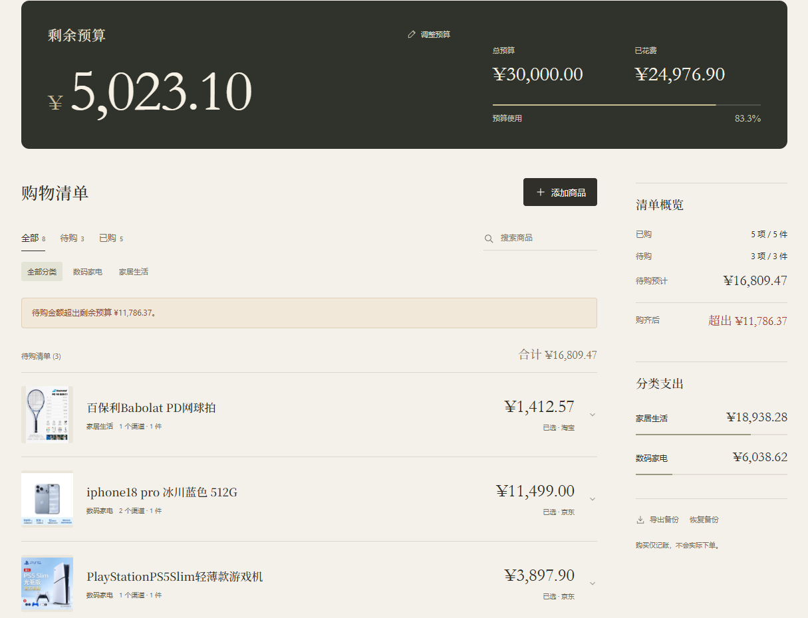

# Shopping Budget Planner

**English** · [简体中文](README.zh-CN.md)

A local-first shopping planner for comparing offers, tracking purchases, and seeing how much of your budget is left. Built for Singles' Day and everyday shopping.

**[🚀 Live demo](https://jaqenhu.github.io/Shopping-budget-planner/)**

`single-file HTML` · `vanilla JavaScript` · `local-first storage` · `GitHub OAuth` · `Supabase`

## Preview



## Features

- **Budget tracking.** Set a budget and see what you have spent, what is left, and when you go over. Marking or undoing a purchase updates your remaining budget automatically.
- **Price comparison.** Record final prices, product links, variants, and discount terms from multiple retailers.
- **Shopping list.** Add photos, organize items by category, search your list, and review purchased and pending items or spending by category.
- **Backup and sync.** Save data in your browser, export and restore JSON backups with photos, or sign in with GitHub to sync across devices.

> Enter prices and discounts manually. Marking an item as purchased records the expense.

## Quick start

- **Online.** Open the live demo, sign in with GitHub, and add an item. Once the app confirms the change has synced, sign in with the same account on another device and refresh to see it there.
- **Offline.** Download [`index.html`](index.html) and open it in your browser. You can use it immediately, and records stay in that browser.
- **Move existing data online.** Export a JSON backup, sign in to the hosted app, and restore the backup. New accounts start with an empty list.

Offline edits are saved locally and can be retried when you reconnect. If edits conflict across devices, you can choose which version to keep. Export a backup before clearing browser data.

## Deploy your own copy

1. Create a Supabase project and run [`supabase/schema.sql`](supabase/schema.sql) in its SQL editor.
2. Set your Supabase project URL, public publishable key, and deployment URL (`siteUrl`) in `CLOUD_CONFIG` in [`src/cloud-bridge.js`](src/cloud-bridge.js).
3. Create a GitHub OAuth App. Set its homepage URL to your deployment URL and its authorization callback URL to `https://<project-ref>.supabase.co/auth/v1/callback`.
4. Enable the GitHub provider in Supabase and enter your OAuth app's client ID and client secret. Set the Site URL and allowed redirect URL to your deployment URL.
5. Run the commands below from the repository root. Push the updated files and configure GitHub Pages to publish from `main` and `/(root)`. Open the deployed site and verify sign-in and sync.

```sh
node scripts/embed-runtime.cjs
node --test tests/*.test.cjs
```

The generated `index.html` contains everything needed to run the app. If the deployment URL changes, update `siteUrl` and the OAuth and Supabase URL settings, then regenerate `index.html`.

## Data and credentials

The browser uses a public Supabase publishable key. Supabase Row Level Security (RLS) restricts each account to its own data. Keep the GitHub client secret, database password, and Supabase secret or `service_role` keys out of the frontend and repository.

This project bundles Supabase JS **2.118.0**. See the [Supabase JS license](vendor/SUPABASE-LICENSE.txt).
