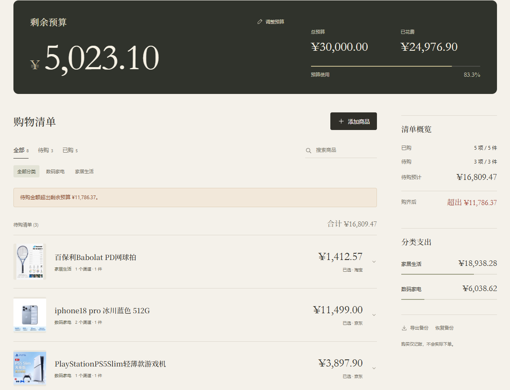

# >_ Shopping Budget Planner · 购物预算规划器 🛒

从双十一需求出发的购物小工具：整理清单、手动比价、跟踪预算，日常购物也能用。

**[🚀 在线体验](https://jaqenhu.github.io/Shopping-budget-planner/)** · **[GitHub 仓库](https://github.com/jaqenhu/Shopping-budget-planner)**

`single HTML` · `vanilla JS` · `local first` · `GitHub OAuth` · `Supabase`

---

## 🖼️ 页面预览



## 🧩 主要功能

- **💰 预算与记账**：查看余额和超支提醒，标记 / 撤销购买自动调整预算。
- **🔎 多渠道比价**：记录到手价、链接、规格及优惠条件。
- **🏷️ 商品清单**：配图、分类、搜索、已购 / 待购分组和支出统计。
- **💾 备份与同步**：本地保存、含图片的 JSON 备份、GitHub 登录跨设备同步。

> 价格和优惠条件需手动填写；“购买”只记录支出，不会在电商平台下单。

## ⚡ 打开就用

- **在线使用**：打开页面 → GitHub 登录 → 添加商品。等顶部显示 **「已同步至云端」** 后，其他设备登录同一账号，刷新即可读取。
- **离线使用**：下载 `index.html`，直接用浏览器打开，无需安装依赖。记录保存在当前浏览器中。
- **迁移数据**：先导出 JSON 备份，再到在线页面登录并「恢复备份」。新账号从空清单开始。

断网修改暂存本机，联网后可重试；多端冲突时可选择保留版本。清理浏览器数据可能丢失本地记录，建议定期备份。

## 🛠️ 自己部署一份

1. 创建 Supabase 项目，执行 [`supabase/schema.sql`](supabase/schema.sql)。
2. 在 [`src/cloud-bridge.js`](src/cloud-bridge.js) 的 `CLOUD_CONFIG` 填入 Project URL、公开 Publishable Key 和网站地址 `siteUrl`。
3. 在 GitHub 创建 OAuth App：Homepage URL 填网站地址，回调填 `https://<项目-ref>.supabase.co/auth/v1/callback`。
4. 在 Supabase 的 GitHub Provider 填入 Client ID / Client Secret，并将 Site URL 和 Redirect URLs 配为网站地址。
5. 运行以下命令，上传到 GitHub，Pages 选择 `main` → `/(root)` 发布，再验证登录与同步。

```sh
node scripts/embed-runtime.cjs
node --test tests/*.test.cjs
```

运行页面只需生成后的 `index.html`。改名或换域名后，需同步更新 `siteUrl`、OAuth 和 Supabase 跳转配置，并重新嵌入源码。

## 🔐 数据与密钥

前端使用公开 **Publishable Key**，数据库通过 **RLS** 按账号隔离。Client Secret、数据库密码及 service_role / secret key 不写入前端或仓库；私人数据与备份已由 `.gitignore` 排除。

Supabase JS **2.118.0**，授权见 [`vendor/SUPABASE-LICENSE.txt`](vendor/SUPABASE-LICENSE.txt)。

---

`/* 随手一做，够用就好。愿清单越来越短，余额撑到最后。 */` 🛒 → 💸 → 🧘
